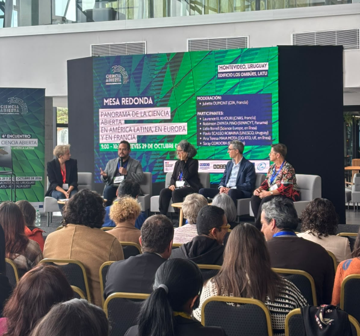
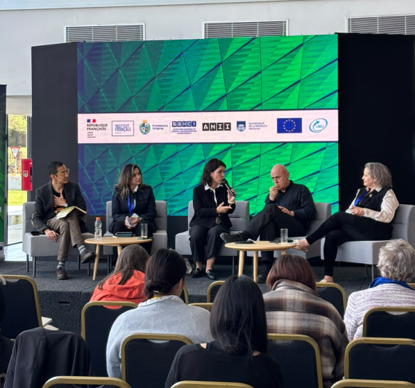

**Representantes del Consejo Directivo de LA Referencia participaron en diversas mesas de diálogo sobre acceso abierto, evaluación de la investigación, gestión de datos, inteligencia artificial e infraestructuras digitales, contribuyendo al intercambio de experiencias entre América Latina y Europa.**

Del 28 al 30 de octubre de 2026, LA Referencia participó en el **IV Encuentro Francia–América Latina sobre Ciencia Abierta**, celebrado en Montevideo, Uruguay, en las instalaciones de la Secretaría Nacional de Ciencia y Valorización del Conocimiento. El encuentro reunió a representantes de instituciones científicas, organismos gubernamentales y especialistas de ambas regiones para intercambiar experiencias, analizar desafíos y explorar nuevas oportunidades de cooperación en Ciencia Abierta.

La cuarta edición dio continuidad al diálogo iniciado en Buenos Aires en 2021 y desarrollado posteriormente en São Paulo en 2022 y París en 2023, consolidando un espacio de intercambio en torno a las políticas, prácticas e infraestructuras que favorecen el acceso y la circulación del conocimiento científico.

**LA Referencia contó con una amplia representación de su Consejo Directivo**, cuyos integrantes participaron en la ceremonia de apertura del 28 de octubre, así como en la recepción realizada en la Residencia de Francia y en diversas mesas temáticas durante las jornadas del encuentro.

Entre las intervenciones, **Robinson Zapata Pino**, representante del nodo de Panamá (<a href="https://www.senacyt.gob.pa/" target="_blank" rel="noopener">Secretaría Nacional de Ciencia, Tecnología e Innovación, SENACYT</a>), participó en la mesa dedicada al panorama de la Ciencia Abierta en América Latina, Europa y Francia, un espacio orientado a compartir avances y perspectivas sobre el desarrollo de políticas e iniciativas en ambas regiones.

En el ámbito de las publicaciones científicas, **Pilar Rico**, representante del nodo de España (<a href="https://www.fecyt.es/" target="_blank" rel="noopener">Fundación Española para la Ciencia y la Tecnología, FECYT</a>), formó parte de la mesa sobre modelos innovadores y equitativos de acceso abierto, centrada en las alternativas para ampliar el acceso al conocimiento y promover esquemas de comunicación científica más inclusivos y sostenibles.

Por su parte, **Patricia Muñoz Palma**, representante del nodo de Chile (<a href="https://www.anid.cl/" target="_blank" rel="noopener">Agencia Nacional de Investigación y Desarrollo, ANID</a>), participó en la discusión sobre la evaluación de los investigadores en el contexto de la Ciencia Abierta, una temática vinculada con la evolución de las prácticas de reconocimiento y valoración de la actividad científica.

El encuentro también permitió abordar los avances en el monitoreo de la Ciencia Abierta y la generación de información para comprender su desarrollo. En este espacio, **Federico Cetrangolo, director ejecutivo de LA Referencia**, estuvo a cargo de la moderación de una mesa dedicada a los esfuerzos y avances en monitoreo e investigación sobre Ciencia Abierta, promoviendo el intercambio de experiencias y enfoques entre instituciones de ambas regiones.

La gestión y el intercambio de datos de investigación constituyeron otro de los ejes del programa. **Emanuelle Torino**, representante del nodo de Brasil (<a href="http://www.ibict.br/" target="_blank" rel="noopener">Instituto Brasileiro de Informação em Ciência e Tecnologia, IBICT</a>), y **Juan Maldini**, representante del nodo de Uruguay (<a href="https://www.anii.org.uy/" target="_blank" rel="noopener">Agencia Nacional de Investigación e Innovación, ANII</a>), participaron en la mesa sobre repositorios, capacidades, soberanía y recursos compartidos, en la que se abordaron desafíos relacionados con el desarrollo de infraestructuras y capacidades para la gestión de datos científicos.

Asimismo, la relación entre inteligencia artificial y ciencia abierta ocupó un lugar relevante en las discusiones. **Juan Maldini** moderó la mesa dedicada a los desafíos de la soberanía digital, que contó con la participación de **Luis Eliécer Cadenas, director ejecutivo de <a href="https://www.redclara.net/" target="_blank" rel="noopener">RedCLARA</a> e integrante del Consejo Directivo de la Referencia**.

En este espacio también participó **Bianca Amaro**, del Ministerio de Ciencia, Tecnología e Innovación de Brasil, quien ejerció en dos ocasiones la Presidencia de LA Referencia. Su presencia permitió destacar la continuidad de los vínculos y la trayectoria de colaboración regional en torno al fortalecimiento de la ciencia abierta.

La participación de LA Referencia en este encuentro reafirma la importancia de la cooperación internacional y del trabajo articulado entre instituciones para avanzar hacia modelos de ciencia abierta más equitativos, sostenibles y orientados al interés público.

A través de estos espacios, LA Referencia continúa contribuyendo al diálogo entre América Latina y Europa, promoviendo el intercambio de experiencias y el fortalecimiento de infraestructuras públicas que faciliten el acceso, la visibilidad y la circulación del conocimiento científico.
